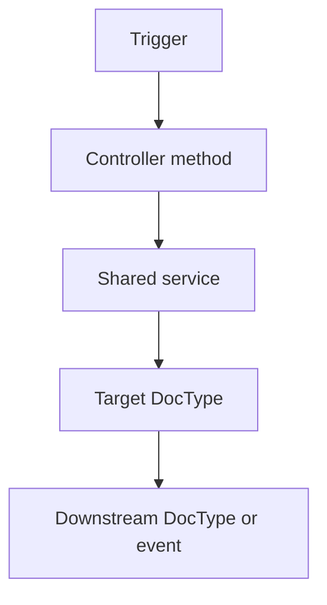
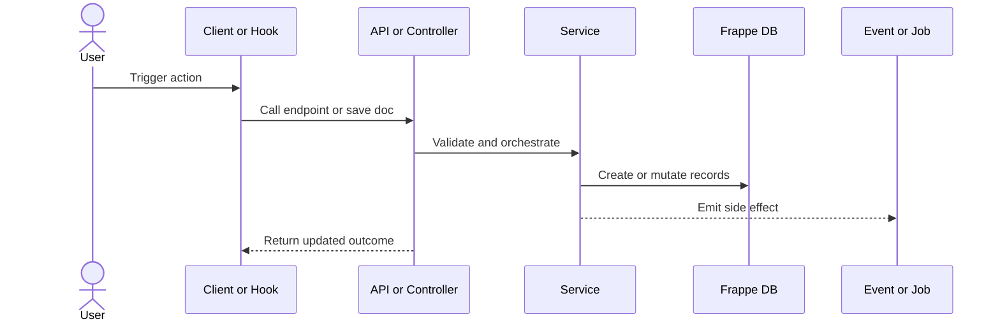
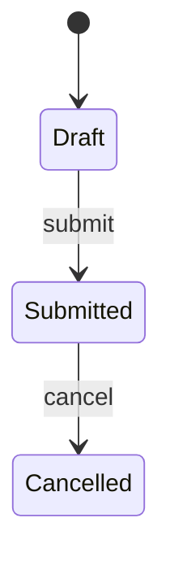

# Flow Output Template

## Doctype Note Template

```md
# <DocType>

## Scope
- app:
- module:
- bench/site:
- question:

## Structural Ownership
- schema:
- controller:
- client script:
- child tables:
- incoming links:

## Entry Points
- hook:
- API:
- button/client action:
- scheduler/background:

## Write Paths
- function:
- trigger:
- mutation:
- downstream side effects:

## Reports, Prints, and Workflow
- report refs:
- print refs:
- workflow refs:

## Open Questions
- ...
```

## Process Note Template

```md
# <Process Name>

## Trigger
- actor:
- entrypoint:

## Happy Path
1. ...
2. ...
3. ...

## Branches
- ...

## Side Effects
- document updates:
- events/jobs:
- integrations:

## Risks
- permissions:
- financial/state correctness:
- unclear ownership:
```

## Mermaid Templates

### Structural Impact Map



### Request To Side Effect



### State Transition View



## Merge Discipline

- keep diagram names stable so later hunts can replace or extend them
- prefer one diagram per question instead of one giant app diagram
- keep unresolved edges in notes beneath the diagram instead of drawing speculative arrows
