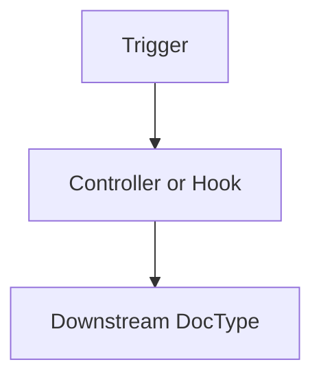
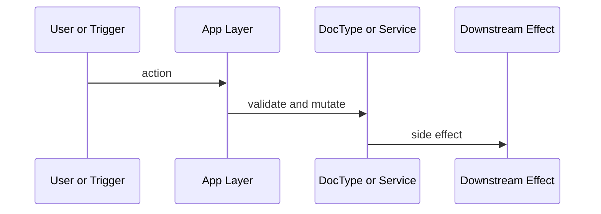

# Canonical Workflow Doc Template

Use this template for major workflow docs.

```md
# <Title>

## Scope And Assumptions

- Scope:
- Assumptions:
- Evidence layers used:

## Ownership Graph

| Surface | Owner | Key files or artifacts | Evidence |
| --- | --- | --- | --- |



## Write Paths And Side Effects

- Function or event:
  - writes:
  - downstream effects:
  - evidence:

## Reconstructed Flow



## Reports, Print Formats, Dashboards, Workflows

- Reports:
- Print formats:
- Dashboards:
- Live workflow states:

## Unresolved Gaps And Next Probes

- Gap:
- Next probe:
```

## Metadata Files

For `_meta` files, keep the structure compact and machine-oriented when possible.

- `baseline.md`: short human-readable snapshot
- `baseline.json`: stable machine-readable contract
- `legacy-doc-map.md`: replacement ledger
